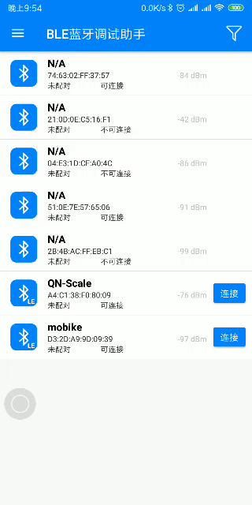

# 发现还有挺多人不知道怎么用kotlin，所以用java重构了，这个库就不维护了。[点击跳转新库](https://github.com/wandersnail/easyble-x)

[English](https://github.com/wandersnail/easyble/blob/master/README_EN.md)

## 推荐一款蓝牙调试APP【蓝牙工坊】

> 面向硬件工程师、嵌入式开发者、电子爱好者的蓝牙调试工具，同时支持BLE低功耗蓝牙与SPP串口蓝牙，一站式完成蓝牙设备测试。各大应用市场搜索【蓝牙工坊】安装即可。

<div align="center">
    
    
    
    
</div>

✅ 实时日志打印，数据秒级展示，支持日志持久化本地保存，调试过程数据不丢失；

✅ 支持多蓝牙设备同时连接，并行收发数据；

✅ 自定义快捷按键，预设指令，一键下发写入数据，省去重复输入；

✅ 日志一键导出、分享，快速保存调试记录，方便复盘、联调沟通；

适合蓝牙模块、单片机、传感器、智能硬件开发调试，无需电脑，手机即可快速完成蓝牙收发调试。

点击下方按钮【蓝牙工坊】

[](https://www.pgyer.com/lanyagongfang)

## 最新版本
[](https://jitpack.io/#wandersnail/easyble)
[](https://maven-badges.herokuapp.com/maven-central/com.github.wandersnail/easyble)

## 功能
- 支持多设备同时连接
- 支持连接同时配对
- 支持搜索已连接设备
- 支持搜索器设置
- 支持自定义搜索过滤条件
- 支持自动重连、最大重连次数限制、直接重连或搜索到设备再重连控制
- 支持请求延时及发送延时设置
- 支持分包大小设置、最大传输单元设置
- 支持注册和取消通知监听
- 支持回调方式，支持使用注解@InvokeThread控制回调线程。注意：观察者监听和回调只能取其一！
- 支持发送设置（是否等待发送结果回调再发送下一包）
- 支持写入模式设置
- 支持设置连接的传输方式
- 支持连接超时设置

## 配置

1. module的build.gradle中的添加依赖，自行修改为最新版本，同步后通常就可以用了：
```
dependencies {
	...
	implementation 'com.github.wandersnail:easyble:1.1.10'
}
```

2. 如果从jcenter下载失败。在project的build.gradle里的repositories添加内容，最好两个都加上，有时jitpack会抽风，同步不下来。添加完再次同步即可。
```
allprojects {
	repositories {
		...
		maven { url 'https://jitpack.io' }
		maven { url 'https://dl.bintray.com/wandersnail/android/' }
	}
}
```

## 使用方法(kotlin)

1. 初始化SDK
```
Ble.instance.initialize(application)//在Application中初始化
BleLogger.logEnabled = true//只控制打印，不控制回调
BleLogger.logCallback = object : LogCallback {
	override fun onLog(priority: Int, log: String) {
		when (priority) {
			Log.VERBOSE -> TODO()
			Log.INFO -> TODO()
			Log.DEBUG -> TODO()
			Log.WARN -> TODO()
			Log.ERROR -> TODO()
			Log.ASSERT -> TODO()
		}
	}
}
```

2. 蓝牙搜索
```
//1. 搜索监听
private val scanListener = object : ScanListener {
	override fun onScanStart() {
		
	}

	override fun onScanStop() {
		
	}

	override fun onScanResult(device: Device) {
		//搜索到蓝牙设备
	}

	override fun onScanError(errorCode: Int, errorMsg: String) {
		when (errorCode) {
			ScanListener.ERROR_LACK_LOCATION_PERMISSION -> {//缺少定位权限
				
			}
			ScanListener.ERROR_LOCATION_SERVICE_CLOSED -> {//位置服务未开启
				
			}
		}
	}
}

//2. 添加监听
Ble.instance.addScanListener(scanListener)

//3. 搜索设置
Ble.instance.bleConfig.scanConfig.setScanPeriodMillis(30000)
		.setUseBluetoothLeScanner(true)
		.setAcceptSysConnectedDevice(true)
if (Build.VERSION.SDK_INT >= Build.VERSION_CODES.LOLLIPOP) {
	Ble.instance.bleConfig.scanConfig.setScanSettings(ScanSettings.Builder().setScanMode(ScanSettings.SCAN_MODE_LOW_LATENCY).build())
}

//4. 开始搜索
Ble.instance.startScan()

//停止搜索
Ble.instance.stopScan()

```

3. 连接
```
//连接设置
val config = ConnectionConfig()
config.setDiscoverServicesDelayMillis(500)
config.setAutoReconnect(autoReconnect)
...

//建立连接
Ble.instance.connect(device!!, config, object : ConnectionStateChangeListener {
	override fun onConnectionStateChanged(device: Device) {
		when (device.connectionState) {
			IConnection.STATE_SCANNING -> {

			}
			IConnection.STATE_CONNECTING -> {

			}
			IConnection.STATE_CONNECTED -> {

			}
			IConnection.STATE_DISCONNECTED -> {

			}
			IConnection.STATE_SERVICE_DISCOVERING -> {

			}
			IConnection.STATE_SERVICE_DISCOVERED -> {

			}
			IConnection.STATE_RELEASED -> {

			}
		}
	}

	override fun onConnectFailed(device: Device?, type: Int) {
		when (type) {
			IConnection.CONNECT_FAIL_TYPE_NON_CONNECTABLE -> {}
			IConnection.CONNECT_FAIL_TYPE_UNSPECIFIED_ADDRESS -> {}
			IConnection.CONNECT_FAIL_TYPE_MAXIMUM_RECONNECTION -> {}
		}
	}

	override fun onConnectTimeout(device: Device, type: Int) {
		when (type) {
			IConnection.TIMEOUT_TYPE_CANNOT_CONNECT -> {}
			IConnection.TIMEOUT_TYPE_CANNOT_DISCOVER_SERVICES -> {}
		}
	}
})

//断开指定连接
Ble.instance.disconnectConnection(device)
//断开所有连接
Ble.instance.disconnectAllConnections()

//释放指定连接
Ble.instance.releaseConnection(device)
//释放所有连接
Ble.instance.releaseAllConnections()
```

4. 读写特征值、开启Notify
```
//方式一：
//1. 实例化观察者
val eventObserver = object : EventObserver {
	override fun onBluetoothStateChanged(state: Int) {
	}

	override fun onLogChanged(log: String, level: Int) {
	}

	override fun onCharacteristicRead(device: Device, tag: String, serviceUuid: UUID, characteristicUuid: UUID, value: ByteArray) {
	}

	override fun onRequestFailed(device: Device, tag: String, requestType: Request.RequestType, failType: Int, src: ByteArray?) {
	}

	override fun onCharacteristicWrite(device: Device, tag: String, serviceUuid: UUID, characteristicUuid: UUID, value: ByteArray) {
	}

	override fun onRemoteRssiRead(device: Device, tag: String, rssi: Int) {
	}

	override fun onDescriptorRead(device: Device, tag: String, serviceUuid: UUID, characteristicUuid: UUID, descriptorUuid: UUID, value: ByteArray) {
	}

	override fun onNotificationChanged(device: Device, tag: String, serviceUuid: UUID, characteristicUuid: UUID, descriptorUuid: UUID, isEnabled: Boolean) {
	}

	override fun onIndicationChanged(device: Device, tag: String, serviceUuid: UUID, characteristicUuid: UUID, descriptorUuid: UUID, isEnabled: Boolean) {
	}

	override fun onMtuChanged(device: Device, tag: String, mtu: Int) {
	}

	override fun onPhyRead(device: Device, tag: String, txPhy: Int, rxPhy: Int) {
	}

	override fun onPhyUpdate(device: Device, tag: String, txPhy: Int, rxPhy: Int) {
	}

	override fun onConnectionStateChanged(device: Device) {
	}

	override fun onConnectFailed(device: Device?, type: Int) {
	}

	override fun onConnectTimeout(device: Device, type: Int) {
	}

	override fun onCharacteristicChanged(device: Device, serviceUuid: UUID, characteristicUuid: UUID, value: ByteArray) {
	}
}
//2. 注册观察者
Ble.instance.registerObserver(eventObserver)
//3. 调用相应方法
val connection = Ble.instance.getConnection(device)
connection?.readCharacteristic(tag, service, characteristic)
connection?.enableNotification(tag, service, characteristic)
connection?.disableNotification(tag, service, characteristic)
connection?.writeCharacteristic(tag, service, characteristic, byteArrayOf(0x05, 0x06))
connection?.readRssi(tag)
...
//取消注册观察者
Ble.instance.unregisterObserver(eventObserver)

//方式二：
val connection = Ble.instance.getConnection(device)
connection?.readCharacteristic(tag, service, characteristic, object : CharacteristicReadCallback {
	@InvokeThread(RunOn.MAIN)
	override fun onCharacteristicRead(device: Device, tag: String, serviceUuid: UUID, characteristicUuid: UUID, value: ByteArray) {
	}

	@InvokeThread(RunOn.BACKGROUND)
	override fun onRequestFailed(device: Device, tag: String, requestType: Request.RequestType, failType: Int, src: ByteArray?) {
	}
})
connection?.enableNotification(tag, service, characteristic, object : CharacteristicWriteCallback {
	override fun onCharacteristicWrite(device: Device, tag: String, serviceUuid: UUID, characteristicUuid: UUID, value: ByteArray) {
	}

	override fun onRequestFailed(device: Device, tag: String, requestType: Request.RequestType, failType: Int, src: ByteArray?) {
	}
})
...
```

5. 释放SDK
```
Ble.instance.release()
```
## 基于此库的BLE调试app
[](http://app.mi.com/details?id=cn.zfs.bledebugger)
[](https://raw.githubusercontent.com/wandersnail/myapks/master/bleutility-v2.1.apk)


